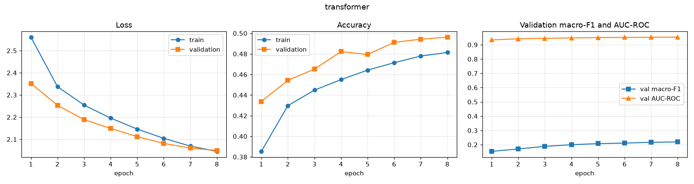

# Workshop 2 — Transformer language model for next-character prediction

Dataset: `flwrlabs/shakespeare` (LEAF). Each sample is a window of 80 characters (`x`) and the next
character (`y`), 76 classes (75 characters + `<UNK>`), with strong class imbalance (the space is
~19% of the targets).

We reuse the data from Workshop 1 without changing it: the split by speaker
(`Workshop_1/data/splits.json`, 70/15/15) and the vocabulary built on train
(`Workshop_1/data/vocab.json`). The test split is only used in `src/evaluate.py`.

## Model (`src/model.py`)

Small decoder-only Transformer (like GPT) at character level, trained from scratch:

| Layer | Output shape | Parameters |
|---|---|---:|
| Token embedding (76 → 128) + position embedding (80 → 128) | (B, 80, 128) | 9,728 + 10,240 |
| 2 Transformer blocks: causal self-attention (4 heads) + feed-forward (128 → 512 → 128), LayerNorm, residuals, dropout | (B, 80, 128) | 396,544 |
| Final LayerNorm, last position | (B, 128) | 256 |
| Linear (128 → 76) | (B, 76) logits | 9,804 |
| **Total** | | **426,572** |

Activations: softmax inside the attention, ReLU in the feed-forward layers, softmax inside the
cross-entropy loss. The causal mask makes each position look only at the previous characters.

**Why a Transformer?** It is the architecture assigned to our team for Workshop 2 (Transformer-based
language models). Self-attention lets every position look directly at all previous characters, and
all positions are processed in parallel. Alternatives considered: LSTM/GRU (read one character at a
time, information from far characters has to pass through many steps) and 1D CNN (limited context).
Pre-trained Transformers (GPT-2, BERT) use sub-word tokens, not our 76-character vocabulary, and are
too large for a 4 GB GPU, so we train from scratch (no transfer learning).

## Training (`src/train.py`)

- Loss: cross-entropy with class weights `1/sqrt(frequency)` computed on train only (for the class
  imbalance). Optimizer: AdamW. Scheduler: cosine annealing (lr → lr/100).
- Regularisation: dropout, weight decay, gradient clipping (norm 5), early stopping (patience 3 on
  validation macro-F1).
- The best epoch (highest validation macro-F1) is saved to `checkpoints/model_best.pt`.
- Logs: loss, accuracy, macro-F1, AUC-ROC and learning rate per epoch in TensorBoard (`runs/`);
  learning curves in `reports/figures/`.

A full epoch on the 3 M training rows takes ~12 min on our GPU, so we train on a fixed random
subsample (seed 42): 200k rows for the search and 1M rows for the final model.

**Hyperparameter search** (3 epochs, 200k train rows, 100k val rows) — `reports/hparam_search.csv`:

| lr | dropout | weight decay | val macro-F1 | val accuracy |
|---:|---:|---:|---:|---:|
| **3e-3** | **0.1** | **1e-4** | **0.153** | **0.466** |
| 1e-3 | 0.1 | 1e-4 | 0.150 | 0.458 |
| 3e-3 | 0.3 | 1e-2 | 0.139 | 0.439 |
| 1e-3 | 0.3 | 1e-2 | 0.132 | 0.430 |
| 3e-4 | 0.1 | 1e-4 | 0.106 | 0.414 |
| 3e-4 | 0.3 | 1e-2 | 0.091 | 0.395 |

**Final hyperparameters:** lr 3e-3, dropout 0.1, weight decay 1e-4, batch size 512, 8 epochs,
1M train rows, class weights, seed 42. Best epoch: 8 (validation macro-F1 0.2194).



Train and validation loss go down together and stay close, so there is no overfitting. The train
loss is a bit higher than the validation loss because it is measured during training, with dropout
on and averaged over the epoch while the weights change. The validation macro-F1 improves in every
epoch (best epoch = last), so more epochs or more data would probably still help.

## Results

Final metrics of the model (`python -m src.evaluate`):

| Metric | Train (200k sample) | Validation | Test (full, 644k rows) |
|---|---:|---:|---:|
| Accuracy | 0.506 | 0.496 | 0.498 |
| F1 macro | 0.270 | 0.219 | 0.239 |
| F1 weighted | 0.514 | 0.504 | 0.505 |
| AUC-ROC | 0.961 | 0.956 | 0.943 |

Workshop 1 baselines were evaluated on a 10k-row sample of the test split, so the comparison uses
the same 10k rows (`reports/results_comparison.csv`):

| Model | Accuracy | F1 macro | F1 weighted | AUC-ROC |
|---|---:|---:|---:|---:|
| Majority class (space) | 0.183 | 0.005 | 0.057 | 0.500 |
| Logistic regression (W1) | 0.369 | 0.108 | 0.324 | 0.871 |
| Naive Bayes (W1) | 0.334 | 0.107 | 0.304 | 0.849 |
| Random forest (W1) | 0.308 | 0.140 | 0.350 | 0.820 |
| **Transformer (W2)** | **0.495** | **0.258** | **0.504** | **0.954** |

The Transformer is clearly better than all the baselines because it uses all 80 characters of
context, while the baselines only used the last 5. It predicts the space (80%) and common letters
well and fails with uppercase letters and punctuation (`;`, `:`), which start new words or sentences.

## How to run

```bash
python -m venv .venv
.venv/Scripts/python.exe -m pip install -r requirements.txt   # Windows
# Workshop 1 data must exist first (Workshop_1: python -m src.dataset --prepare)

python -m src.model        # architecture + forward-pass check
python -m src.train --search --epochs 3 --max-train-samples 200000 --max-val-samples 100000
python -m src.train --run-name transformer --epochs 8 --max-train-samples 1000000 --class-weights --lr 3e-3 --dropout 0.1 --weight-decay 1e-4
python -m src.evaluate     # test metrics, comparison table, confusion matrix
python -m src.test_model   # loads model_best.pt and predicts the next character
tensorboard --logdir runs
```

The results notebook is `notebooks/workshop2_results.ipynb` (it only loads saved results).

## Hardware and time

NVIDIA GTX 1650 (4 GB), 7.4 GB RAM, Windows 11, torch 2.14.1 (CUDA 12.6).
Search: 17 min. Final training: 38 min. Evaluation: ~3 min.

## Notes about Workshop 1

- `Workshop_1/src/baselines.py` crashes on Windows with the default matplotlib backend; we ran it
  with `MPLBACKEND=Agg` and copied its test metrics to `reports/baselines_workshop1.csv`.
- `splits.json` and `vocab.json` were checked (no speaker in more than one split) and were not
  changed.

## Structure

```
src/          model.py, train.py, evaluate.py, test_model.py
notebooks/    workshop2_results.ipynb
checkpoints/  model_best.pt
runs/         TensorBoard logs (search runs + final run)
reports/      hparam_search.csv, results_comparison.csv, baselines_workshop1.csv, figures/
```
