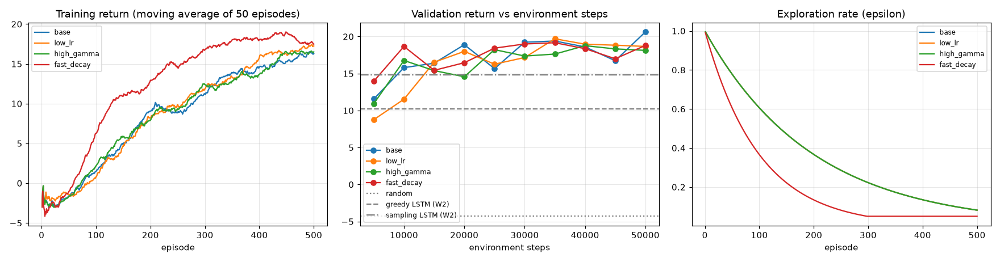
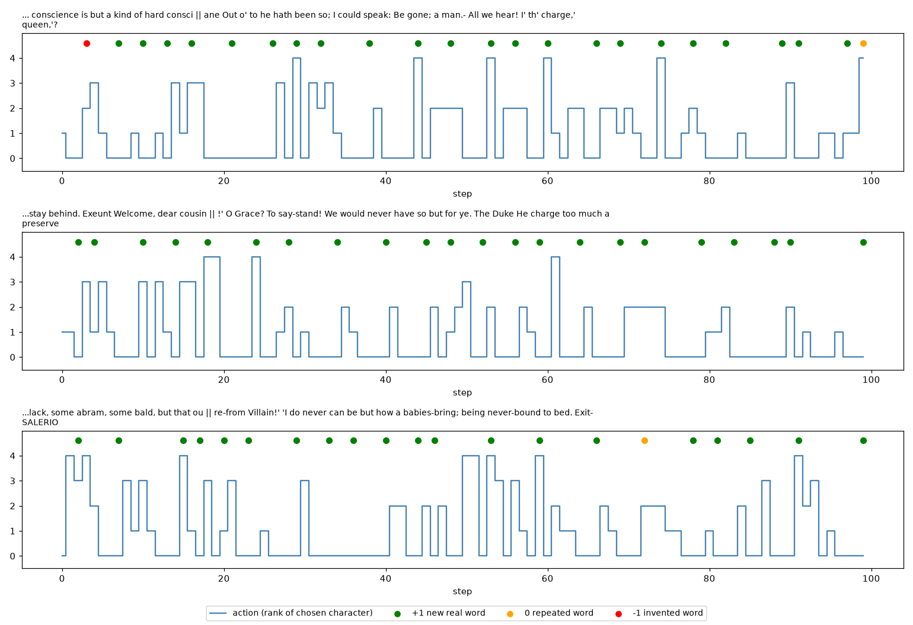

# Workshop 3 — RL for controllable text generation

Team 8 (text generation). Same dataset as Workshops 1 and 2: `flwrlabs/shakespeare`, with the
Workshop 1 split by speaker. The Workshop 2 LSTM (`../Workshop_2/checkpoints/model_best.pt`) is used
as the text generator, and a DQN agent learns to control what it writes.

## 1. MDP formulation

**Problem statement.** When the Workshop 2 LSTM always writes its most likely character (greedy
decoding), it writes real words but falls into loops:

```
...my conscience is but a kind of hard consci | ence. Therefore, what was the King? What shall I be
but the King? What shall I be but the King? What
```

The goal of the agent is to **control the generation so that the text has real Shakespeare words
without repeating them**. This is a sequential decision problem: choosing a letter now decides
whether the word that is being written can still become a real word several steps later, so a
supervised model that predicts one character at a time does not optimise it directly. There are
no labels for "good" choices, only a score (reward) that we can compute after each word, so RL is
a natural fit.

**State** (22 numbers, all in [0, 1]). At each step the LSTM proposes its 5 most likely next
characters. For each candidate the agent sees:
1. its LSTM probability,
2. whether it ends the current word (space or punctuation),
3. whether it keeps the word valid (the new prefix exists in the dictionary, or the finished word
   is a real word),
4. whether it would finish a word that was already written in this episode.

Plus 2 global features: length of the current word / 10 and step / 100. The dictionary has 22,688
words taken from the **training** split only.

**Actions.** Discrete, 5 actions: action *i* = write the candidate with rank *i* (0 = most likely
character according to the LSTM). Restricting the choice to the top 5 keeps the text close to what
the language model considers plausible.

**Transition.** `s_{t+1} = f(s_t, a_t)`: the chosen character is appended to the text, the LSTM reads
the last 80 characters and proposes 5 new candidates, and the features are recomputed. Given the
starting context the transition is **deterministic** (the LSTM is fixed, in eval mode). The only
randomness is the starting context, a random 80-character window of the dataset.

**Reward.** Given when a word ends (the agent writes a space or punctuation after a word):

| Event | Reward |
|---|---:|
| the word is real and new in this episode | +1 |
| the word is real but already written in this episode | 0 |
| the word does not exist (invented) | −1 |
| any other step (in the middle of a word) | 0 |

The reward is not sparse (a word ends every ~5 characters), but it is delayed: the letters chosen
inside a word only get credit when the word ends, so the agent must learn with a discount factor
(γ) to value future rewards. The quantity to maximise is the cumulative reward of the episode.

**Episode termination.** Each episode starts from a random 80-character context and ends after
100 generated characters (fixed horizon). The return measures how many new real words were written
minus the invented ones (maximum ≈ 20–25).

## 2. Environment (`src/env.py`)

`TextGenerationEnv` subclasses `gymnasium.Env` with `action_space = Discrete(5)`,
`observation_space = Box(0, 1, (22,))`, `reset()`, `step()` and `render()` (prints the context and
the generated text). Episodes start from train contexts (training), 30 fixed validation contexts
(model selection) or 100 fixed test contexts (final evaluation), so the agent is tested on
speakers it never saw.

**Random-policy diagnostics** (`python -m src.env`, 100 episodes on validation contexts,
`reports/figures/random_policy.png`):

| Metric | Value |
|---|---|
| Mean return | −2.94 (std 3.28, min −11, max 7) |
| Episode length | always 100 (fixed horizon) |
| Action frequency | 0.202 / 0.199 / 0.208 / 0.197 / 0.194 (all actions occur) |

The random policy invents many words (negative return), which is expected and confirms that the
reward and termination work.

## 3. Agent (`src/agent.py`)

**DQN** (Mnih et al., 2015), a good fit for a small discrete action space:
- Q-network: MLP 22 → 64 → 64 → 5 with ReLU (5,957 parameters).
- Experience replay buffer (20,000 transitions, batch 64, 500 random warm-up steps).
- Target network updated every 500 steps.
- ε-greedy exploration: ε starts at 1.0 and is multiplied by the decay after every episode
  (minimum 0.05).
- Huber loss, Adam optimizer, gradient clipping (norm 10).

**Training** (`src/train.py`): 500 episodes (50,000 environment steps) per configuration. Every 50
episodes the agent is evaluated without exploration on the 30 validation contexts. The best
checkpoint (highest validation return) is saved to `checkpoints/agent_best.pt`. Per-episode return,
episode length, ε, loss and the validation return are logged to TensorBoard (`runs/workshop3/`).
Seed 42.

## 4. Hyperparameter search

| Config | Learning rate | γ | ε decay | Best val return | Best episode | Steps to beat greedy LSTM | Minutes |
|---|---:|---:|---:|---:|---:|---:|---:|
| **base** | 1e-3 | 0.95 | 0.995 | **20.63** | 500 | 5,000 | 12.5 |
| low_lr | 1e-4 | 0.95 | 0.995 | 19.70 | 350 | 10,000 | 11.7 |
| high_gamma | 1e-3 | 0.99 | 0.995 | 18.77 | 400 | 5,000 | 10.5 |
| fast_decay | 1e-3 | 0.95 | 0.990 | 19.17 | 350 | 5,000 | 11.4 |



All configurations learn: the training return goes from about −3 (random behaviour) to 16–19, and
the validation return goes above the greedy LSTM (10.2) and the sampling LSTM (14.8). With
`low_lr` the agent learns more slowly at the beginning. With `fast_decay` the training return rises
fastest because the agent stops exploring earlier, but its validation return does not end higher:
less exploration means fewer alternatives tried. The validation return goes up and down from one
evaluation to the next (only 30 contexts), so the differences between configurations are small.
The **base** configuration was selected.

## 5. Test evaluation (`src/evaluate.py`)

100 fixed test contexts (speakers never seen), same contexts for every policy:

| Policy | Return (mean ± std) | New real words | Repeated words | Invented words | Words / episode | Mean log-prob (fluency) |
|---|---:|---:|---:|---:|---:|---:|
| Random | −2.75 ± 3.42 | 38.8% | 6.5% | 54.7% | 17.4 | −2.84 |
| Greedy LSTM (W2 model alone) | 10.24 ± 2.57 | 51.8% | 46.0% | 2.2% | 20.7 | **−0.77** |
| Sampling LSTM (W2 model alone) | 14.61 ± 3.56 | 84.4% | 8.0% | 7.6% | 19.0 | −1.11 |
| **DQN agent (W3)** | **20.47 ± 2.21** | **92.6%** | **4.6%** | 2.8% | 22.8 | −1.52 |

Mean log-prob = average log-probability that the LSTM gives to the chosen characters (higher =
more "natural" for the language model). Workshop 1 and 2 did not measure the same quantity (they
measured next-character accuracy: 0.37 for the best W1 baseline and 0.55 for the W2 LSTM), so the
Workshop 2 model is included in the table as the greedy and sampling baselines.

**Sample trajectories** (`reports/trajectories.txt`, `reports/figures/trajectories.png`):

```
...but that ou
  greedy LSTM (W2): r prophecy. I will be but the prize. I will be but the prize. I will be but the prize. I will be but
  DQN agent (W3):   re-from Villain!' 'I do never can be but how a babies-bring; being never-bound to bed. Exit-SALERIO
```



The figure shows, for 3 test episodes, the action taken at every step (rank of the chosen
character) and the reward when each word ends (green +1, orange 0, red −1). The agent often takes
the most likely character (action 0) inside a word, and chooses other candidates more often at the
start of a word, which is where it decides to write a different word instead of repeating one.

## 6. Sample efficiency

- The agent beats the greedy LSTM on validation after **5,000 environment steps** (50 episodes) and
  reaches its best result after 50,000 steps. The whole search used 4 × 50,000 = 200,000 steps.
- The Workshop 2 LSTM needed many more examples: 1.5 million labelled windows × 10 epochs
  (15 million examples) for the final model.
- The comparison is not fully independent: the agent does not learn the language from zero, it
  builds on the LSTM (its candidates and probabilities). RL only learns a small policy (5,957
  parameters) on top of the supervised model. Learning the whole language model with RL alone
  would need far more interactions, because the reward only says whether a word is good, not
  which character is correct.

## 7. Discussion

- **Did RL beat supervised learning?** For the goal we defined (new real words), yes: the agent
  doubles the return of the greedy LSTM (20.47 vs 10.24) and almost removes the repetitions (4.6%
  vs 46.0%) while keeping invented words low (2.8%). It also beats sampling, which avoids loops
  but invents more words (7.6%). For next-character accuracy, the supervised LSTM is still the
  right tool; RL is used here for a different goal.
- **Trade-off / limitation:** the mean log-prob of the agent (−1.52) is lower than greedy and
  sampling, so its text is less natural for the language model. The reward only checks that words
  are real and new, not grammar, so the agent learns to write many short different words even when
  the sentence makes little sense ("I do never can be but how a babies-bring"). A next step would
  be adding a fluency term to the reward.
- **Key challenges:** designing the reward (a first version with 50-character episodes left little
  room to improve over greedy, because the loops appear later), and the delayed credit for the
  letters inside a word.
- **Exploration vs exploitation:** at the beginning (ε ≈ 1) the agent behaves randomly and invents
  words (return ≈ −3). As ε decreases it exploits what it learned. Decaying ε faster gives higher
  training return sooner but not a better final validation return.

## How to run

Uses the same environment as Workshop 2 plus `gymnasium` (`pip install -r requirements.txt`).
Needs the Workshop 1 data and the Workshop 2 checkpoint.

```bash
python -m src.env        # random-policy diagnostics (100 episodes)
python -m src.train      # hyperparameter search (4 configs x 500 episodes, ~46 min on GPU)
python -m src.evaluate   # test evaluation, baselines and trajectories (~10 min)
tensorboard --logdir runs/workshop3
```

Hardware: NVIDIA GTX 1650 (4 GB). Seed 42.

## Structure

```
src/          env.py, agent.py, baselines.py, train.py, evaluate.py
checkpoints/  agent_best.pt
runs/         workshop3/ TensorBoard logs (one folder per configuration)
reports/      hparam_search.csv, training_history.csv, test_comparison.csv,
              trajectories.txt, figures/, logs/
```
