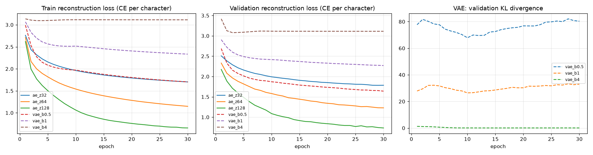
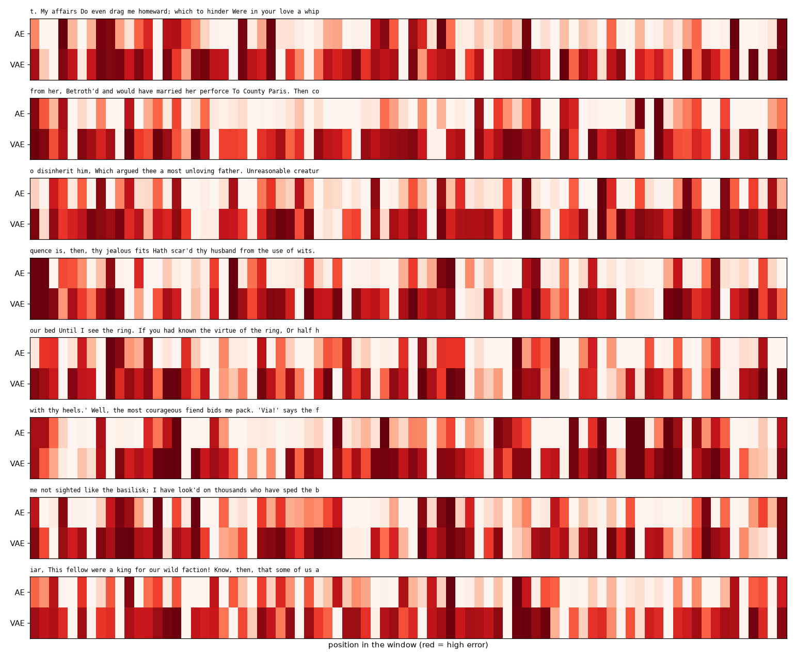
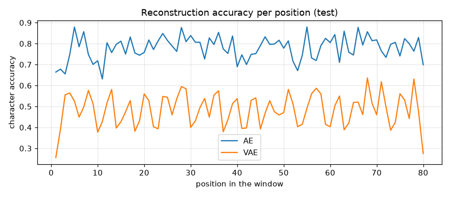
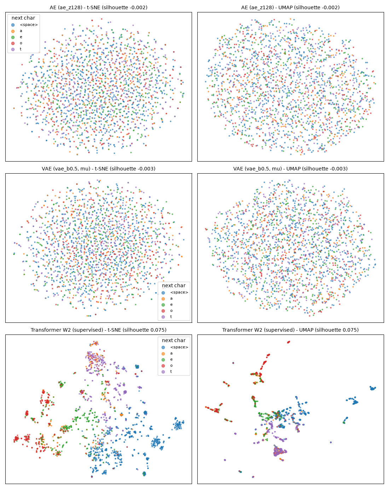

# Workshop 4 — Autoencoders and VAEs for semantic compression

Team 8 (text generation). Same data as Workshops 1–3: `flwrlabs/shakespeare`, windows of 80
characters, with the Workshop 1 split by speaker. The goal is **semantic compression**: compress each
80-character window into a small latent vector and reconstruct it, and see what structure these
unsupervised representations capture compared with the supervised Transformer of Workshop 2.

To keep training fast we use fixed random subsamples (seed 42): 200,000 train, 20,000 validation and
20,000 test windows.

## Motivation

Workshops 1 and 2 learned from labels (the next character). An autoencoder learns without labels,
only by reconstructing its own input, so it shows what can be learned from the text alone. A good
compression must keep the information needed to rebuild the window (letters, spaces, word shapes),
and comparing it with the supervised model tells us how much the label changes the representation.

## Models (`src/autoencoder.py`)

| Part | AE | VAE |
|---|---|---|
| Input | 80 character ids → embedding (76 → 16), flattened (1,280) | same |
| Encoder | Linear 1280 → 512, ReLU → Linear 512 → 256, ReLU | same |
| Bottleneck | Linear 256 → z | Linear 256 → μ and Linear 256 → log σ², z = μ + σ·ε, ε ~ N(0, I) |
| Decoder | Linear z → 256, ReLU → Linear 256 → 512, ReLU → Linear 512 → 80 × 76 | same |
| Output | 76 logits for each of the 80 positions | same |
| Loss | cross-entropy per character (summed over the window) | cross-entropy + β · KL |

The windows always have 80 characters, so we treat them as fixed-size vectors and use
fully-connected layers (simple and fast). The data is categorical (characters), so the
reconstruction loss is cross-entropy, not MSE. KL = −½ Σ(1 + log σ² − μ² − σ²). For the VAE we use
KL annealing: β grows linearly from 0 to its value in the first 10 epochs.

## Training (`src/train_ae.py`)

30 epochs, Adam (lr 1e-3), batch 256, seed 42. The epoch with the lowest validation loss is kept.
Train and validation reconstruction loss (and KL) per epoch are logged to TensorBoard
(`runs/workshop4/`). Total time ≈ 20 minutes on a GTX 1650.

| Run | Model | z | β | Train data | Val CE / char | Val char accuracy | Val KL | Val silhouette |
|---|---|---:|---:|---|---:|---:|---:|---:|
| ae_z32 | AE | 32 | – | all | 1.783 | 45.8% | – | −0.007 |
| ae_z64 | AE | 64 | – | all | 1.229 | 62.5% | – | −0.004 |
| **ae_z128** | AE | 128 | – | all | **0.734** | **77.9%** | – | −0.003 |
| **vae_b0.5** | VAE | 128 | 0.5 | all | 1.640 | 48.4% | 80.3 | −0.005 |
| vae_b1 | VAE | 128 | 1 | all | 2.275 | 33.7% | 32.6 | −0.008 |
| vae_b4 | VAE | 128 | 4 | all | 3.112 | 18.7% | 0.07 | −0.171 |
| ae_normal | AE | 128 | – | normal only | 1.595 | 53.1% | – | −0.005 |
| vae_normal | VAE | 128 | 1 | normal only | 2.920 | 21.8% | 7.2 | −0.019 |



- **Latent dimension:** a bigger z keeps more information. With z = 128 the AE recovers 78% of the
  characters, with z = 32 only 46%. `ae_best.pt` = z 128.
- **β:** a bigger β pushes the latent space towards N(0, I) and the reconstruction gets worse. With
  β = 4 the KL goes to almost 0: the encoder stops using the latent code (**posterior collapse**) and
  the decoder only predicts the most common character of each position (18.7% accuracy). The
  silhouette is the same or lower with bigger β: the KL does not organise the space by the next
  character. `vae_best.pt` = β 0.5 (best validation reconstruction).

## Reconstruction on test (`src/evaluate_ae.py`)

| Model | MSE | CE / char | Char accuracy | Space | Lowercase | Uppercase | Punctuation |
|---|---:|---:|---:|---:|---:|---:|---:|
| AE (z 128) | 0.306 | 0.723 | 78.0% | 98.6% | 74.4% | 52.5% | 74.4% |
| VAE (β 0.5) | 0.621 | 1.638 | 48.4% | 97.4% | 37.4% | 28.7% | 42.4% |

MSE = squared difference between the one-hot input and the predicted probabilities (summed over the
76 classes, averaged over positions). Examples (`reports/reconstruction_examples.txt`):

```
original | from her, Betroth'd and would have married her perforce To County Paris. Then co
AE       | gror her, Hetroth'd and would have married her reiforse tn Count. saris. Shen co
VAE      |  for wort me hithet and woeld tite be ledd har se lesle to foraly Rerin, Thar so
```





**What is hardest to reconstruct:** spaces are almost always right (98%), because the word lengths are
easy to keep. Uppercase letters are the hardest (52% for the AE), then lowercase letters inside rare
words; common words ("would have married her") come back almost perfect. The VAE keeps the shape of
the text (spaces, word lengths) but changes most letters, and it is worse at the first and last
positions of the window. The AE errors look like spelling mistakes ("reiforse" for "perforce").

## Anomaly detection (`src/evaluate_ae.py`)

The dataset has no normal/abnormal classes, so following the workshop we used the majority class as
"normal": windows whose next character is a **space** (19%). The other windows are the "anomalies".
`ae_normal` and `vae_normal` were trained and selected only on normal windows. The anomaly score is
the reconstruction error (and reconstruction error + KL for the VAE). AUC-ROC on the 20,000 test
windows:

| Method | AUC-ROC |
|---|---:|
| Majority class (W1 baseline) | 0.500 |
| AE trained on normal data (reconstruction error) | **0.712** |
| VAE trained on normal data (reconstruction error) | 0.617 |
| VAE trained on normal data (reconstruction error + KL) | 0.623 |
| Transformer W2, supervised (score = 1 − P(space)) | 0.972 |

The AE detects something: windows that are followed by a space end with a complete word, and the
model trained on them reconstructs these windows better than the ones that end in the middle of a
word. Still, the supervised Transformer is much better, because it was trained exactly to predict
the next character. AUC-ROC does not need a threshold; if one were needed it should be chosen on
the validation set. The cumulative table of Workshops 1, 2 and 4 is in `reports/cumulative_results.csv`.

## Latent space (`src/analyze_latent.py`)

2,000 test windows whose next character is one of the 5 most frequent (space, e, t, o, a), encoded
with the AE (z), the VAE (μ) and the frozen Workshop 2 Transformer (vector of the last position).
Silhouette score on the full 128-dimensional vectors, with the next character as label:

| Representation | Silhouette |
|---|---:|
| AE (z 128) | −0.002 |
| VAE (β 0.5, μ) | −0.003 |
| Transformer W2 (supervised) | **0.075** |



**Supervised vs. unsupervised:** in the AE and VAE plots the colours are completely mixed: their
latent space is organised by what is needed to rebuild the whole window (which letters and words
appear and where), not by the next character, which is not even part of their input. The
Transformer, trained with the label, forms clear groups by next character (silhouette 0.075 vs ≈ 0).
Label supervision makes the representation focus on the task; unsupervised compression keeps
general information about the text, useful for reconstruction but not organised by that label.

## How to run

Same environment as Workshop 2 plus `umap-learn` (`pip install -r requirements.txt`). Needs the
Workshop 1 data and the Workshop 2 checkpoint.

```bash
python -m src.train_ae        # 8 runs (3 AE, 3 VAE, 2 for anomaly detection), ~20 min on GPU
python -m src.evaluate_ae     # reconstruction metrics, examples, anomaly detection
python -m src.analyze_latent  # t-SNE, UMAP and silhouette scores
tensorboard --logdir runs/workshop4
```

## Structure

```
src/          autoencoder.py, train_ae.py, evaluate_ae.py, analyze_latent.py
checkpoints/  ae_best.pt, vae_best.pt, ae_normal.pt, vae_normal.pt
runs/         workshop4/ TensorBoard logs (one folder per run)
reports/      training_summary.csv, reconstruction_metrics.csv, reconstruction_examples.txt,
              silhouette_scores.csv, cumulative_results.csv (W1, W2 and W4 results), figures/
```
